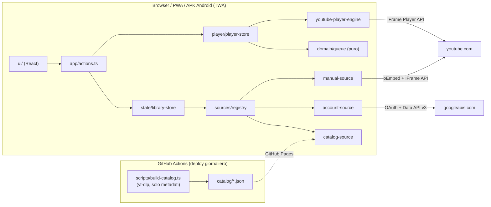

# Architettura

## Panoramica

## Strati

| Strato      | Cartella       | Può dipendere da                 | Note                                           |
| ----------- | -------------- | -------------------------------- | ---------------------------------------------- |
| Dominio     | `src/domain/`  | niente                           | Puro e testato. Usato anche dagli script Node. |
| Sorgenti    | `src/sources/` | domain, state (settings), config | Una cartella per sorgente, stessa interfaccia. |
| Player      | `src/player/`  | domain, state                    | Unico punto che parla con l'iframe YouTube.    |
| Stato       | `src/state/`   | domain, sources                  | Store zustand.                                 |
| App         | `src/app/`     | tutto tranne ui                  | Routing, azioni, effetti globali, PWA.         |
| Interfaccia | `src/ui/`      | tutto                            | Solo presentazione + chiamate ad azioni/store. |

## Stato (store zustand)

| Store              | File                                | Persistito in localStorage | Contenuto                                                         |
| ------------------ | ----------------------------------- | -------------------------- | ----------------------------------------------------------------- |
| `useSettingsStore` | `src/state/settings-store.ts`       | sì (`pp:settings`)         | lingua, tema, tipo musica/video scelto, playlist aggiunte, filtri |
| `useLibraryStore`  | `src/state/library-store.ts`        | no                         | elenco playlist per sorgente, playlist caricate                   |
| `usePlayerStore`   | `src/player/player-store.ts`        | sì (`pp:player`)           | coda, stato, volume, ripeti                                       |
| `usePlayerClock`   | `src/player/player-store.ts`        | no                         | tempo corrente e durata (cambia 2 volte al secondo)               |
| `useAuthStore`     | `src/sources/account/auth-store.ts` | sì (`pp:auth`)             | token Google (max 1 ora), profilo                                 |
| `useToastStore`    | `src/state/toast-store.ts`          | no                         | notifiche temporanee                                              |
| `useInstallStore`  | `src/app/pwa.ts`                    | no                         | prompt di installazione PWA                                       |

Il tempo di ripresa (`pp:player:resume-time`) è salvato a parte ogni 5 secondi, per non riscrivere
tutta la coda ad ogni tick.

## Ciclo di vita del player

1. L'utente preme Riproduci → `actions.playPlaylistByKey()` carica la playlist (library store) e
   chiama `usePlayerStore.playPlaylist()`.
2. Il player store crea la coda (`domain/queue.ts`) e chiede all'engine di caricare il video.
3. L'engine crea l'iframe **la prima volta** dentro `<PlayerViewport/>` e poi riusa sempre lo stesso.
4. Gli eventi YouTube (`onStateChange`, `onError`) tornano allo store:
   - `ENDED` → `queue.next('ended')` (rispetta "ripeti brano") → video successivo o fine coda;
   - errore (video rimosso, incorporamento vietato…) → video segnato come non riproducibile,
     salto automatico dopo 1,2 s; dopo 5 errori di fila si ferma.
5. Mentre suona, un timer aggiorna `usePlayerClock` e salva la posizione.
   - `status` è ciò che YouTube ha comunicato; `playIntent` è ciò che l'utente vuole (play/pausa).
     Il pulsante play/pausa e il titolo della finestra seguono `playIntent`, perché **durante le
     pubblicità YouTube non invia eventi di stato**: basandosi solo su `status` il pulsante
     resterebbe bloccato.
6. Al riavvio: la coda viene ripristinata, il player mostra la miniatura; premendo play il video
   riparte dal punto salvato.

## Layout

Un solo albero React; la disposizione cambia solo con il CSS (`src/styles/layout.css`,
`player.css`), breakpoint **1024px**:

- **Desktop**: tre colonne — sidebar | contenuto | pannello "In riproduzione" (video 16:9, controlli,
  volume, coda).
- **Telefono**: striscia del player in alto (nascosta se la coda è vuota), contenuto, barra di
  navigazione in basso. Per la musica il player è un quadrato 200×200 con titolo e comandi a
  fianco; per i video è largo 16:9.

## PWA e cache

`vite-plugin-pwa` genera il service worker (`registerType: autoUpdate`):

- app shell (JS/CSS/HTML/icone) in precache → l'app si apre anche offline;
- `catalog/*.json` → _stale-while-revalidate_;
- miniature `i.ytimg.com` → _cache-first_ (30 giorni, max 800).
- I video **non** vengono mai messi in cache (vietato e comunque impossibile con l'iframe).

## Android

`android/` è una Trusted Web Activity: un launcher che apre `publicUrl` in Chrome a schermo intero.
Nessuna logica: ogni modifica al sito arriva anche all'app senza ripubblicare l'APK.
Dettagli in [ANDROID.md](ANDROID.md).
