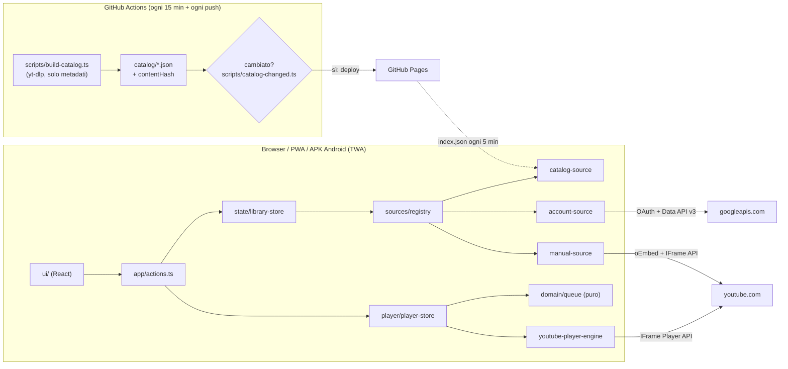

# Architettura

**In breve**: una web app React + TypeScript (Vite), installabile come PWA e pubblicata su GitHub
Pages; l'APK Android è un guscio (Trusted Web Activity) che apre lo stesso sito. Le playlist
arrivano da tre sorgenti; la riproduzione usa il player ufficiale di YouTube.

## Panoramica

## Strati

Le dipendenze vanno solo verso il basso della tabella.

| Strato         | Cartella       | Può dipendere da                     | Note                                                          |
| -------------- | -------------- | ------------------------------------ | ------------------------------------------------------------- |
| App            | `src/app/`     | tutto                                | Layout, routing, azioni, effetti globali, PWA                 |
| Interfaccia    | `src/ui/`      | player, state, sources, i18n, domain | Componenti React; `art/` illustrazioni; `a11y/` accessibilità |
| Testi          | `src/i18n/`    | state (lingua), domain (tipi)        | `it.ts` è la fonte di verità                                  |
| Player         | `src/player/`  | state, i18n, domain                  | Unico punto che parla con l'iframe YouTube                    |
| Stato          | `src/state/`   | sources, domain, config              | Store zustand                                                 |
| Sorgenti       | `src/sources/` | state (settings), domain, config     | Una cartella per sorgente, stessa interfaccia                 |
| Configurazione | `src/config/`  | `app.config.json`                    | Identità del progetto                                         |
| Dominio        | `src/domain/`  | niente                               | Puro, testato, importato anche dagli script Node              |

## Stato (store zustand)

| Store               | File                                | Salvato nel browser | Contenuto                                                                      |
| ------------------- | ----------------------------------- | ------------------- | ------------------------------------------------------------------------------ |
| `useSettingsStore`  | `src/state/settings-store.ts`       | sì (`pp:settings`)  | lingua, tema, scorciatoie, tipo musica/video scelto, playlist aggiunte, filtri |
| `useLibraryStore`   | `src/state/library-store.ts`        | no                  | playlist per sorgente, playlist caricate, versione del catalogo                |
| `usePlayerStore`    | `src/player/player-store.ts`        | sì (`pp:player`)    | coda, stato YouTube, intenzione play/pausa, volume, ripeti                     |
| `usePlayerClock`    | `src/player/player-store.ts`        | no                  | tempo e durata (cambiano 2 volte al secondo)                                   |
| `useAuthStore`      | `src/sources/account/auth-store.ts` | sì (`pp:auth`)      | token Google (max 1 ora), profilo                                              |
| `useToastStore`     | `src/state/toast-store.ts`          | no                  | notifiche visibili                                                             |
| `useAnnouncerStore` | `src/state/announcer-store.ts`      | no                  | messaggi per i lettori di schermo                                              |
| `useInstallStore`   | `src/app/pwa.ts`                    | no                  | prompt di installazione                                                        |

Tutte le chiavi `localStorage` sono in `src/state/storage-keys.ts`.

## Effetti globali (`src/app/effects.ts`)

Hook chiamati una volta da `<App/>`: tema (`data-theme`), lingua (`<html lang>`), titolo della
finestra, focus al titolo dopo ogni navigazione, annuncio del brano, scorciatoie, caricamento
della libreria e **controllo del catalogo ogni 5 minuti** (più al ritorno in primo piano e quando
torna la rete). `index.html` applica tema e lingua salvati prima del primo disegno.

## Layout

Un solo albero React; la disposizione cambia solo con il CSS, breakpoint **1024px**:

- **Desktop**: sidebar | contenuto | pannello del lettore (video 16:9, disco, comandi, coda).
- **Telefono**: striscia del lettore in alto (nascosta a coda vuota), contenuto, barra in basso.
  Musica: lettore quadrato 200×200 con comandi a fianco (impilati sotto i 360px); video: largo 16:9.

`<NowPlayingPanel/>` e `<PlayerViewport/>` non vengono mai smontati (vedi [lettore.md](lettore.md)).

## PWA e cache

`vite-plugin-pwa` genera il service worker (aggiornamento automatico):

- app shell (JS, CSS, HTML, icone, font latini) in precache → si apre anche offline;
- `catalog/*.json` → _network first_ (timeout 4 s): online sempre aggiornato, offline la copia;
- miniature `i.ytimg.com` → _cache first_ (30 giorni, max 800);
- i video **non** vengono mai messi in cache.

## Android

`android/` è una Trusted Web Activity senza logica: ogni deploy del sito arriva anche all'app.
Dettagli in [android.md](android.md).
